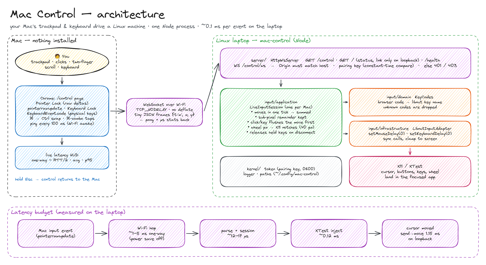

# Mac Control

Drive your Linux laptop with your Mac's trackpad and keyboard over Wi-Fi. Open one link in Chrome on the Mac, click once, and the Mac's trackpad, clicks, two-finger scroll and keyboard control the Linux machine next to it. Nothing to install on the Mac.

**Landing page:** https://mohamedjs.github.io/mac-control/



## Latency

Measured on the laptop, over its own Wi-Fi address:

| What | Time |
|---|---|
| Send → cursor actually moved | 1.15 ms |
| Inject one move (XTest) | 0.12 ms |
| Server work per event | ~12 µs |
| Ping round trip (median / p95) | 0.86 / 1.2 ms |

The Wi-Fi hop to the Mac adds roughly 1–5 ms one way when power saving is off. The controller page shows your real one-way estimate, average and p95 live.

Why it is fast:

- libnut sleeps **10 ms after every mouse and keyboard call** by default. Mac Control sets both delays to 0, which takes a move from ~11 ms to ~0.1 ms.
- Native calls are synchronous, so there is no promise queue. Moves that arrive in the same tick are added together and injected once, and a click or key press flushes any pending move first so the order stays right.
- The WebSocket runs with `TCP_NODELAY` and no compression, and sends tiny JSON frames.
- The page uses `pointerrawupdate`, which skips the wait for the next screen refresh. While you are in control it also sends a 100 ms ping, which keeps both Wi-Fi radios from dozing.

## Get started

On the Linux machine (X11 session, Node 20+):

```bash
git clone https://github.com/mohamedjs/mac-control.git
cd mac-control
npm install
npm start
```

It prints a pairing link like `http://192.168.1.x:3030/control#t=<key>`. The local page at `http://127.0.0.1:3030` has a Copy button, and `npm run link` prints the link again.

On the Mac:

1. **Once:** in Chrome open `chrome://flags/#unsafely-treat-insecure-origin-as-secure`, add `http://<laptop-ip>:3030`, enable it and relaunch. You need this for under 10 ms: without it Chrome holds each move until the next screen refresh (up to ~16 ms), and ⌘W / ⌘T / Esc stay with Chrome.
2. Open the pairing link and click **Take control**.
3. **Hold Esc** to give control back to the Mac.

## Commands

```bash
npm start                         # start the server (port 3030)
node bin/mac-control.js link      # print the pairing link
node bin/mac-control.js doctor    # check display, native input, LAN address
node bin/mac-control.js rotate-key  # revoke old links (restart afterwards)
node bin/mac-control.js start --port 4000
```

To start it with your desktop session:

```bash
mkdir -p ~/.config/systemd/user
sed "s|@APP_DIR@|$PWD|" packaging/linux/mac-control.service > ~/.config/systemd/user/mac-control.service
systemctl --user daemon-reload && systemctl --user enable --now mac-control
```

## Features

- **⌘ acts as Ctrl**, so ⌘C, ⌘V and ⌘Z work as your hands expect. A switch on the page turns this off; Mac Ctrl then becomes Super.
- **Physical key codes**: the Linux keyboard layout decides which character you get.
- **Trackpad scroll**: pixel deltas become X11 wheel notches (40 px each), and the leftover fraction is kept for the next scroll. Horizontal scroll works too.
- **No stuck keys**: every held key and button is released when the socket drops, the page loses focus or you leave capture.
- **⌘-combo fix**: macOS sends no key-up for other keys while ⌘ is held, so those combos are sent as taps, repeats included.

## Security

- The controller socket needs a pairing key, stored with mode 0600 at `~/.config/mac-control/pairing-key`. Keys are compared in constant time.
- Upgrades whose `Origin` is a different website are refused. This blocks cross-site WebSocket hijacking from any page you visit.
- The key travels in the URL fragment (`#t=`), so it never appears in an HTTP request line. The status page shows the link only to requests from the machine itself.
- Anyone who has the link and is on your network can drive the machine. `rotate-key` revokes it.

## Limits

- Linux needs an **X11** session. Under Wayland, only XWayland apps receive input; log in with "Ubuntu on Xorg".
- macOS keeps ⌘Tab, ⌘Space and ⌘Q. No web page can capture them.
- Use Chrome or another Chromium browser. Safari has no Keyboard Lock.
- For steady latency, turn off Wi-Fi power saving on the laptop: `nmcli connection modify "<wifi>" 802-11-wireless.powersave 2 && nmcli connection up "<wifi>"`. Use 5 GHz Wi-Fi or Ethernet if you can.

## Project layout

```text
src/
├── main.js                 CLI: start · link · rotate-key · doctor
├── composition-root.js     the only place modules are wired together
├── kernel/                 token (pairing key), logger, per-OS paths
└── modules/
    ├── input/
    │   ├── domain/         KeyCodes: browser code → libnut key name (pure)
    │   ├── application/    LiveInputSession: coalescing, ordering, release-on-drop
    │   └── infrastructure/ LibnutInputAdapter: zero-delay native injection
    └── server/
        └── infrastructure/ HttpWsServer, control-page.html, local status page
docs/                       architecture (Excalidraw source, PNG, SVG) + render script
site/                       landing page (GitHub Pages)
test/                       unit, integration and boundary tests (npm test)
```

Re-render the diagram after editing `docs/diagram/scene.js`:

```bash
PLAYWRIGHT_MODULE=/path/to/node_modules/playwright/index.mjs npm run diagram
```

## License

MIT
